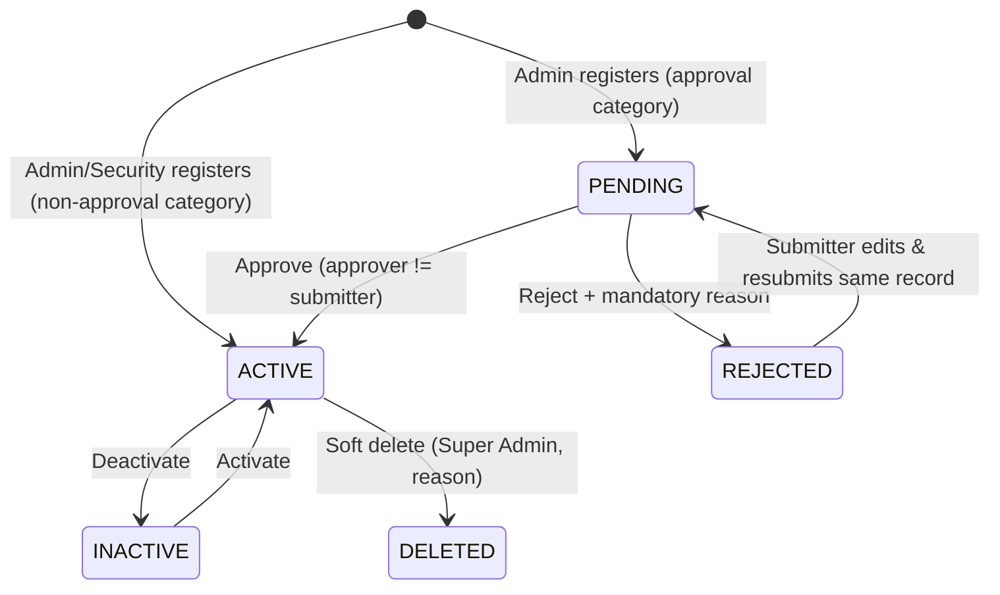
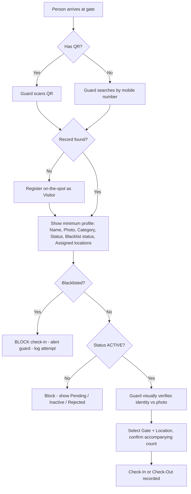

# Maitribodh Access Management System (MAMS) — Detailed Requirements Specification

> **Purpose of this file:** Single source of truth for implementing MAMS (Phase 1 / MVP). Written to be used as context by GitHub Copilot and developers.
>
> **Sources consolidated:** RBAC document (Role-Based Access Control — MaitriBodh AMS), Clarification Q&A v1.2 (client responses), Client meeting decisions (Sec. 3.1 – 3.11).
>
> **Conventions used in this file**
> - `MUST` = mandatory, `SHOULD` = recommended, `MAY` = optional.
> - **[ASSUMPTION]** = implementation default chosen where sources are silent. Keep it configurable.
> - **[OPEN]** = not finalized by client. Implement the stated default behind a config flag; do not hardcode.
> - Requirement IDs (e.g. `REG-05`) are stable — reference them in commits, tests and PRs.

---

## Table of Contents

1. [System Overview](#1-system-overview)
2. [Scope — Phase 1](#2-scope--phase-1)
3. [Tech Stack, Project Structure & Coding Standards](#3-tech-stack-project-structure--coding-standards)
4. [Roles & RBAC](#4-roles--rbac)
5. [Master Data](#5-master-data)
6. [Authentication & Portal User Management](#6-authentication--portal-user-management)
7. [Person Registration](#7-person-registration)
8. [Registration Approval Workflow](#8-registration-approval-workflow)
9. [QR Code Management](#9-qr-code-management)
10. [Gate Operations — Verification, Check-In / Check-Out](#10-gate-operations--verification-check-in--check-out)
11. [Occupancy, Open Visits & Overstay](#11-occupancy-open-visits--overstay)
12. [Bulk Upload](#12-bulk-upload)
13. [Blacklist Management](#13-blacklist-management)
14. [Dashboard & Reporting](#14-dashboard--reporting)
15. [Audit Logging](#15-audit-logging)
16. [Notifications](#16-notifications)
17. [Data Protection (DPDP)](#17-data-protection-dpdp)
18. [Non-Functional Requirements](#18-non-functional-requirements)
19. [Data Model (Simplified)](#19-data-model-simplified)
20. [API Endpoint Outline](#20-api-endpoint-outline)
21. [Status & Enum Reference](#21-status--enum-reference)
22. [Open Items & Resolved Conflicts](#22-open-items--resolved-conflicts)

---

## 1. System Overview

MAMS controls and records entry/exit of people at the Maitribodh Ashram (single ashram, multiple premises and gates).

**Core principles**

| # | Principle |
|---|-----------|
| P1 | Every person entering the premises must be a registered person in the system (or an accompanying member added under a registered primary person). |
| P2 | A person is registered once; every visit is a new check-in / check-out event against the same record. |
| P3 | Each registered person gets a unique QR code, generated once at registration. |
| P4 | People cannot self-register. Registration is done by Admin / Super Admin (and by Security Personnel for on-the-spot Visitors only). |
| P5 | Security personnel validate identity manually at the gate (no OTP, no access-control hardware). |
| P6 | Categories, sub-categories, locations, gates, departments and job roles are master data — **never hardcoded**. |
| P7 | Every data modification is audit-logged. |

---

## 2. Scope — Phase 1

### 2.1 In scope

| Module | Notes |
|---|---|
| Portal login & user management | Super Admin, Admin, Security Personnel |
| Master data | Categories, Sub-categories, Locations/Premises, Gates, Departments, Job Roles, Permission levels |
| Person registration | Single registration + accompanying members + bulk upload |
| Approval workflow | For categories configured as `requiresApproval = true` |
| QR code | Unique per person, generate / regenerate / download / print |
| Gate operations | QR scan or mobile search, check-in / check-out with gate + location |
| Occupancy | Live "Inside" list, manual reconciliation, overstay flag |
| Blacklist | Add / remove with reason; blocks check-in |
| Reporting | Dashboard, visit history with export (CSV/Excel) |
| Audit logs | Full audit trail with old/new values |
| Responsive web app (PWA) | Works on desktop, tablet and mobile browsers |

### 2.2 Out of scope (Phase 1)

| Item | Reason / Note |
|---|---|
| OTP authentication | Recurring operational cost |
| SMS / WhatsApp / Email notifications | Recurring operational cost |
| Automatic QR sharing (SMS/Email/WhatsApp) | QR distribution is manual |
| Native Android / iOS app | Depends on budget; mobile team to estimate |
| Access-control hardware (turnstiles, RFID, etc.) | Not planned; manual monitoring |
| Legacy data migration from existing site | Client confirmed not required |
| Multi-ashram / multi-branch | Single ashram only |
| Multi-language UI | English only now; Hindi & Marathi later (build i18n-ready) |
| MFA | Recommended for Super Admin in future |
| Analytics export (other than visit history) | Next phase |
| Offline mode at gate | Fallback is paper register + bulk upload |

---

## 3. Tech Stack, Project Structure & Coding Standards

### 3.1 Stack

| Layer | Technology |
|---|---|
| Frontend | React (PWA, responsive) — project `Maitribudh-UI`, dev port `3000` |
| Backend API | Node.js + Express — project `Maitribudh-API`, dev port `6200` |
| Database | PostgreSQL (AWS RDS) |
| File storage | AWS S3 (person photos, bulk upload files, QR images if persisted) |
| Auth | JWT (access token) + bcrypt password hashing |
| Secrets | AWS Secrets Manager + KMS |
| Hosting | CloudFront + WAF → ALB → Node API on ECS Fargate |
| CI/CD / IaC | GitHub Actions, ECR, Terraform |
| Email/SMTP | **Not used** — no SMTP keys in solution |

Root project name: `Maitribudh-AMS` containing `Maitribudh-API` and `Maitribudh-UI`. Separate config per environment (dev / qa / uat / prod).

### 3.2 Coding standards

- ES6+ everywhere; ESLint enforced; clean, formatted, documented code (JSDoc on public functions).
- React: small, modular components; higher-order components / hooks for cross-cutting concerns (auth guard, permission guard).
- Common logic in `utils/`; **all hardcoded constants in a constants/config file** (status values, permission codes, limits, cut-off times).
- Permission checks MUST be done on the server (middleware) — UI hiding is only cosmetic.
- All list APIs paginated, sortable and filterable.
- All write APIs MUST create an audit log entry (via shared service/middleware).
- Prefer soft delete (`isDeleted`, `deletedAt`, `deletedBy`) over hard delete.

---

## 4. Roles & RBAC

### 4.1 Portal roles

> Portal **role** (what a login can do) is separate from person **category** (who the person is). A Staff/Volunteer is not automatically an Admin; a person whose job title is "Security Guard" does not automatically get Security Personnel portal access.

| Role | Purpose |
|---|---|
| **Super Admin** | Full system ownership, governance and accountability |
| **Admin** | Daily registration, operations and explicitly delegated approvals |
| **Security Personnel** | Gate verification, check-in/out, on-the-spot Visitor registration |
| **User** (registered person) | Retrieve own QR, limited self-service (no portal login in Phase 1 — see [OPEN-02](#22-open-items--resolved-conflicts)) |

Implement roles as **a permission matrix** (role → permission codes), not as hardcoded `if (role === 'ADMIN')` checks. Use RBAC + attribute-based restrictions: role grants baseline permission; category, record ownership, registration status and assigned gate/location constrain it.

### 4.2 Permission matrix

| Function | Super Admin | Admin | Security Personnel | User |
|---|---|---|---|---|
| View dashboard | Full | Full | Gate dashboard only | None |
| View person profiles | All | All | Minimum fields for verification | Own permitted profile |
| Register person | Any category | Any category | Visitor only (fallback) | No |
| Edit person records | All | Yes (permitted fields) | No | No |
| Approve / reject registrations (approval categories) | Yes | Yes, if assigned approval authority; never own submission | No | No |
| Delete person records | Yes (soft delete, reason mandatory) | No by default | No | No |
| Activate / deactivate accounts | All | Operational accounts, subject to policy | No | No |
| Configure categories / sub-categories | Yes | Yes | No | No |
| Configure departments & job roles | Yes | Yes | No | No |
| Configure locations / gates | Yes | Yes | No | No |
| Assign portal roles | Yes | No | No | No |
| Scan QR / search by mobile | Yes | Yes | Yes | Own QR retrieval only |
| Check in / check out | Yes | Yes | Yes | No |
| Override blacklist block | **No** | **No** | **No** | No |
| View live occupancy | Full | Full | Gate activity / occupancy as authorized | No |
| View visit history | All | All | Operational activity only | Own history, if enabled |
| Export reports | All | All | No by default | No |
| View audit logs | Full | Operational logs, if granted | Own gate actions only, if enabled (default: off) | No |
| Manage blacklist | Yes | Add/review if delegated | View flag only | No |
| Bulk upload | Yes | If granted `person.bulk_upload` | No | No |
| System configuration | Yes | No | No | No |

### 4.3 Permission codes

| Module | Codes |
|---|---|
| Person management | `person.view`, `person.create`, `person.edit`, `person.delete`, `person.bulk_upload` |
| Registration approval | `person.approve`, `person.reject` |
| QR | `qr.generate`, `qr.regenerate`, `qr.download`, `qr.print` |
| Gate operations | `gate.profile_lookup`, `gate.checkin`, `gate.checkout`, `gate.visitor_register` |
| Occupancy | `occupancy.view`, `occupancy.reconcile` |
| Reporting | `report.dashboard`, `report.history`, `report.export` |
| Master data | `master.category.manage`, `master.subcategory.manage`, `master.department.manage`, `master.job_role.manage`, `master.location.manage`, `master.gate.manage` |
| Access administration | `access.role.assign`, `access.account.manage`, `access.policy.manage` |
| Security | `blacklist.view`, `blacklist.manage`, `audit.view`, `audit.export` |
| Self-service | `self.qr.retrieve`, `self.profile.view`, `self.profile.correction_request` |

**Default role → permission seed**

| Role | Permissions |
|---|---|
| Super Admin | All codes |
| Admin | `person.view/create/edit/bulk_upload`, `person.approve/reject` (if delegated), `qr.*`, `gate.*`, `occupancy.*`, `report.*`, `master.*`, `blacklist.view`, `blacklist.manage` (if delegated), `audit.view` (operational, if granted) |
| Security Personnel | `gate.profile_lookup`, `gate.checkin`, `gate.checkout`, `gate.visitor_register`, `occupancy.view` (gate scope), `occupancy.reconcile`, `blacklist.view`, `qr.print` [ASSUMPTION] |
| User | `self.qr.retrieve`, `self.profile.view` (if enabled), `self.profile.correction_request` |

### 4.4 Category → permission level

- Each category MAY be mapped to a **permission level** (meeting 3.2).
- Persons in that category inherit the permissions/access mapped to it (e.g., which locations they may access).
- Category permission level controls **person access rights** (locations), not portal login rights.

### 4.5 Mandatory authorization rules

| ID | Rule |
|---|---|
| AUTHZ-01 | **Deny by default** — any permission not explicitly granted is denied. |
| AUTHZ-02 | **Enforce server-side** — every API checks permission in middleware. |
| AUTHZ-03 | **Separate role from category.** |
| AUTHZ-04 | **Record-level access** — a User can retrieve only their own permitted information. |
| AUTHZ-05 | **Workflow state** — Pending registrations cannot be treated as Active (no QR use / check-in). |
| AUTHZ-06 | **Blacklist block** — check-in MUST fail for a blacklisted person irrespective of role. |
| AUTHZ-07 | **Audit sensitive actions** — actor, action, target record, timestamp, outcome, reason. |
| AUTHZ-08 | **Prevent privilege escalation** — Admin cannot grant themselves or others Super Admin; cannot edit own role. |
| AUTHZ-09 | **Preserve history** — prefer deactivation / soft delete. |
| AUTHZ-10 | **QR is a lookup key, not proof of authorization** — always re-validate status + blacklist server-side on scan. |
| AUTHZ-11 | Approver MUST NOT be the original submitter of the registration. |
| AUTHZ-12 | Super Admin: no shared accounts; reason mandatory for delete, blacklist changes, sensitive permission changes. |
| AUTHZ-13 | Audit history cannot be edited or deleted through any interface. |

---

## 5. Master Data

All master data is managed via UI by Super Admin / Admin. **No approval workflow** for master data changes; changes take effect immediately (meeting 3.1). Delete = soft delete; a record in use cannot be hard-deleted.

Common fields for every master: `id`, `name`, `code`, `description`, `isActive`, `isDeleted`, `createdBy/At`, `updatedBy/At`.

### 5.1 Categories (`MD-CAT`)

| ID | Requirement |
|---|---|
| MD-CAT-01 | Admin can **Create, Update, Delete** categories (Activate/Deactivate also supported [ASSUMPTION — confirm]). |
| MD-CAT-02 | Category name unique (case-insensitive) among non-deleted records. |
| MD-CAT-03 | Category attributes: `name`, `code`, `permissionLevelId`, `requiresApproval` (bool), `defaultLocationIds[]`, `allowAccompanyingMembers` (bool), `isActive`. |
| MD-CAT-04 | Cannot delete a category that has active persons — show error; allow deactivate instead. |
| MD-CAT-05 | Deactivated categories are hidden from registration dropdowns but remain on existing records/reports. |

**Seed data (meeting 3.1):** `Volunteer`, `Active Member`, `Visitor`.
- "Devotee" is **not** a separate category — covered under `Visitor`.
- Other categories mentioned in earlier documents (Staff, Parivar Member, Vendor, Contractor, Participant) can be created by Admin through the master if needed — see [OPEN-01](#22-open-items--resolved-conflicts).

### 5.2 Sub-categories (`MD-SUB`)

- Linked to a parent category. Admin can Add / Edit / Activate-Deactivate / Delete without code change.
- Optional on registration unless the category has active sub-categories [ASSUMPTION].

### 5.3 Permission levels (`MD-PERM`)

- Named levels (e.g., `Open Areas Only`, `Restricted – Kitchen`, `All Areas`) defining which locations a person may access.
- Mapped to categories; persons inherit them. Per-person override via assigned locations (see 7.4).

### 5.4 Locations / Premises (`MD-LOC`)

| ID | Requirement |
|---|---|
| MD-LOC-01 | Location attributes: `name`, `code`, `type` (`OPEN` / `RESTRICTED`), `isActive`. |
| MD-LOC-02 | Examples: Main Gate area, Kitchen, Offices, Residential Areas, School / Gurukul, Goushala. |
| MD-LOC-03 | Location access rights are configurable (via permission level and per-person assignment). |

### 5.5 Gates (`MD-GATE`)

- Multiple gates/access points. Attributes: `name`, `code`, `locationId` (optional), `isActive`.
- Security Personnel MAY be assigned to one or more gates; their default gate pre-selected on the gate screen.

### 5.6 Departments & Job Roles (`MD-DEPT`, `MD-JOB`)

- Masters for staff-type persons. A person can be assigned one Department + one Job Role (optional fields, required only if category is configured to need them [ASSUMPTION]).
- Only Admin/Super Admin can change a person's Department / Job Role; **no re-approval** needed (Q14).

---

## 6. Authentication & Portal User Management

| ID | Requirement |
|---|---|
| AUTH-01 | First **Super Admin is created manually by IT** (DB seed script / migration). No sign-up page. |
| AUTH-02 | Super Admin creates Admin users. Super Admin assigns / revokes portal roles. Admin MAY create Security Personnel accounts if granted `access.account.manage` [ASSUMPTION]. |
| AUTH-03 | Portal users are created **without a password**. On first login, user enters username and sets their password on the login page (first-login flow). |
| AUTH-04 | Change / forgot password happens on the login portal using **old password + new password**. No reset link, no OTP, no email, no WhatsApp. If a user forgets the password completely, Super Admin/Admin resets the account to "password not set" state so it goes through first-login again [ASSUMPTION]. |
| AUTH-05 | Passwords hashed with bcrypt; password policy (min 8 chars, upper, lower, digit, special) in constants config. |
| AUTH-06 | JWT access token; Security Personnel session lasts **at least 12 hours** (one shift). Other roles: configurable (default 8h) [ASSUMPTION]. |
| AUTH-07 | Log Login, Logout, Failed Login Attempts in audit. Lock account after N (config, default 5) consecutive failed attempts; Admin/Super Admin unlocks [ASSUMPTION]. |
| AUTH-08 | Deactivated users cannot log in; active tokens are rejected on next request. |
| AUTH-09 | Admin cannot manage Super Admin accounts or change system-wide security policies. |
| AUTH-10 | No shared Super Admin accounts. MFA is out of MVP scope but design should allow adding it. |

Portal user fields: `fullName`, `username` (mobile or email), `mobile`, `email`, `roleId`, `assignedGateIds[]`, `isActive`, `passwordHash` (nullable until first login), `lastLoginAt`, `failedAttempts`, `lockedUntil`.

---

## 7. Person Registration

### 7.1 Who can register

| Actor | Can register |
|---|---|
| Super Admin | Any category |
| Admin | Any category (approval categories go to Pending) |
| Security Personnel | `Visitor` only, on the spot, when no existing record is found at gate |
| User | Cannot self-register or create another person's record |

### 7.2 Registration fields

| Field | Type | Mandatory | Rules |
|---|---|---|---|
| Full Name | text (max 150) | Yes | Letters, spaces, `.`, `'`, `-` |
| Mobile Number | text | Yes (primary person) | Residents: 10-digit Indian mobile. Non-Residents: international format with country code (E.164) [ASSUMPTION] |
| Email ID | email | No [ASSUMPTION] | Valid email format; no notifications sent |
| Category | dropdown (active categories) | Yes | From master |
| Sub-category | dropdown | Conditional | If category has active sub-categories |
| Assigned Role / Permission Level | dropdown | Yes | Defaults from category; editable by Admin |
| Assigned Location(s) | multi-select | Yes (min 1) | Defaults from category `defaultLocationIds`; Admin can add/remove |
| Resident Status | radio | Yes | `RESIDENT` (default) / `NON_RESIDENT` (Non-Resident / International) |
| Passport Number | text | Conditional | **Disabled** when Resident; **Mandatory** when Non-Resident. Alphanumeric, 6–15 chars [ASSUMPTION] |
| Address | textarea | Conditional | Relevant address details for Non-Resident (Q30); optional for Resident [ASSUMPTION] |
| Photo | image | **Yes** | Live camera capture or file upload (JPG/PNG, max 2 MB [ASSUMPTION]); stored in S3 |
| Department | dropdown | Conditional | If category requires it |
| Job Role | dropdown | Conditional | If category requires it |
| Accompanying Members | list | No | See 7.5 |

### 7.3 Validation & behavior

| ID | Requirement |
|---|---|
| REG-01 | Switching Resident Status to `RESIDENT` clears and disables Passport Number; switching to `NON_RESIDENT` enables and makes it mandatory (UI + server validation). |
| REG-02 | **No duplicate prevention**: the same person may be registered multiple times under different categories. Mobile number, name or other fields MUST NOT block registration. UI MAY show a non-blocking info hint "N records exist with this mobile" [ASSUMPTION]. |
| REG-03 | On save: if category `requiresApproval = false` → status `ACTIVE` and QR generated immediately. If `true` → status `PENDING`, no usable QR until approved. |
| REG-04 | Security on-the-spot Visitor registration: minimal form (Full Name, Mobile, Photo, Resident Status, Passport if Non-Resident, accompanying members); category fixed to `Visitor`; status `ACTIVE`. |
| REG-05 | Editing a person: Admin/Super Admin only. Changes to mobile, email, passport, category, location are audit-logged with old/new values. |
| REG-06 | If a field encoded in the QR changes (e.g., mobile number), the QR is regenerated and the old one becomes invalid immediately (see QR-04). |
| REG-07 | Persons can be Activated / Deactivated by Admin/Super Admin; deactivated persons cannot check in. |
| REG-08 | Delete person: Super Admin only, soft delete, reason mandatory. |
| REG-09 | Users can request correction of personal details only through authorized staff (no self-edit). |

### 7.4 Location assignment

- Admin can assign one or more locations to a person during registration (and later edit).
- Defaults come from the category (e.g., Gurukul teachers/staff automatically tagged to Gurukul).
- Gate/location check-in for a location not assigned to the person shows a **warning** to the guard; guard can still proceed [ASSUMPTION — confirm whether it must block].

### 7.5 Group / accompanying members (contractors, families, children, elderly)

| ID | Requirement |
|---|---|
| GRP-01 | Only the **primary individual** (with a mobile number) is registered as a full person record with a QR. |
| GRP-02 | Accompanying members are added **under the primary registrant** — either by **name** (list of names, optional relation/age-group) or just a **count**. |
| GRP-03 | Covers: contractors with labour teams, families, accompanying children, elderly without mobile phones. |
| GRP-04 | Individual registration for every labourer is **not** mandatory. |
| GRP-05 | Accompanying members do not get their own QR; they enter/exit with the primary person. |
| GRP-06 | At check-in, the guard confirms/enters the number of accompanying members actually present (defaults to registered count); this count is stored on the visit and included in occupancy [ASSUMPTION]. |

---

## 8. Registration Approval Workflow

Applies only to categories with `requiresApproval = true` (earlier documents: Staff and Parivar Member). See [OPEN-01](#22-open-items--resolved-conflicts).



| ID | Requirement |
|---|---|
| APR-01 | Approval by Admin with approval authority or Super Admin. |
| APR-02 | Approver MUST NOT be the original submitter (server-side check). |
| APR-03 | Reject requires a mandatory reason. |
| APR-04 | Submitter can view rejection reason, edit details and **resubmit the same record** (no new registration). |
| APR-05 | Full approval/rejection history is kept per record (who, when, action, reason). |
| APR-06 | Pending persons cannot check in; QR scan shows status "Pending approval". |
| APR-07 | Admin edits to an Active staff-type profile (department/job role etc.) do **not** require re-approval. |
| APR-08 | Pending approvals list with filters (category, submitted by, date). |

---

## 9. QR Code Management

| ID | Requirement |
|---|---|
| QR-01 | Every registered (primary) person has a **unique** QR code — including those created via manual registration and bulk upload. |
| QR-02 | QR is generated **once**, when the person becomes `ACTIVE` (immediately for non-approval categories, on approval for approval categories). No time-based rotation/expiry. |
| QR-03 | QR payload = an opaque, unique, non-guessable token (e.g., UUID v4 / random 128-bit) mapped to the person record — **no PII in the QR** [ASSUMPTION]. Lookup is tied to the registered mobile number. |
| QR-04 | Regeneration (when encoded profile data such as mobile changes, or manually by Admin): new token replaces the old one on the same record; **old QR becomes invalid immediately**. |
| QR-05 | Log QR Generation and QR Regeneration in audit. |
| QR-06 | **No automatic sharing** via SMS / Email / WhatsApp. Distribution is manual: download (PNG/PDF) or print from portal. |
| QR-07 | Front desk / authorized portal users can print the QR on demand for walk-ins. |
| QR-08 | No OTP for QR retrieval (Phase 1). |
| QR-09 | **[OPEN-02] QR lookup access:** Default per RBAC — a self-service lookup page where a person enters registered mobile number to retrieve/download own QR. Client wants to discuss replacing it with a **login-only portal** where only designated members can access QR. Implement behind config flag `QR_PUBLIC_LOOKUP_ENABLED` (default `false` until client confirms). |
| QR-10 | If a mobile number matches multiple records (duplicates allowed), lookup lists each record with Name + Category (masked mobile) for selection. |
| QR-11 | The QR card shows: Name, Category, Photo [ASSUMPTION], QR image, Registration ID. |

---

## 10. Gate Operations — Verification, Check-In / Check-Out

### 10.1 Flow



### 10.2 Requirements

| ID | Requirement |
|---|---|
| GATE-01 | Gate screen works in mobile/tablet browser; QR scan via device camera (web QR scanner library). Manual mobile-number search as alternative. |
| GATE-02 | Guard sees only minimum fields: name, photo, category, registration status, blacklist status, assigned locations, accompanying members. |
| GATE-03 | **Blacklisted person → check-in MUST fail** for every role; show alert; log the attempt. No override. |
| GATE-04 | Only `ACTIVE` persons can check in. |
| GATE-05 | Identity validation is manual by the guard (visual check vs photo / optional photo ID). |
| GATE-06 | Each check-in captures: person, **Check-In Gate**, **Location**, accompanying count, guard (user), timestamp. |
| GATE-07 | Each check-out captures: **Check-Out Gate**, **Location**, guard, timestamp; closes the open visit. |
| GATE-08 | Movement between locations inside the premises can be recorded as a location-tagged event (**Gate Movement**) without closing the visit [ASSUMPTION]. |
| GATE-09 | If the person already has an open visit, the screen offers **Check-Out** (or Movement) instead of a second Check-In. |
| GATE-10 | Guard's assigned gate is pre-selected; guard can change it if permitted. |
| GATE-11 | Location not in person's assigned locations → show warning (see 7.4). |
| GATE-12 | **Fallback when system/network is down:** entries captured manually in a physical register; Registrar/Admin later uploads them via bulk upload (visit-history import template) [ASSUMPTION: separate visit import template]. No offline mode in Phase 1. |
| GATE-13 | Scan-to-result response target ≤ 2 seconds on normal 4G. |

---

## 11. Occupancy, Open Visits & Overstay

| ID | Requirement |
|---|---|
| OCC-01 | System maintains a list of persons currently **"Inside"** (checked in, not checked out). |
| OCC-02 | Headcount = primary persons inside + their accompanying counts; filter by location, gate, category. |
| OCC-03 | "Inside" list visible on Admin dashboard, Security gate dashboard (scoped) and reports. |
| OCC-04 | **No auto-checkout.** Admin and Security can review stale open visits and manually close/correct them (manual reconciliation) with a mandatory remark; logged in audit. |
| OCC-05 | **Overstay:** configurable cut-off per category (e.g., day Visitors / Contractors must vacate by **10:00 PM**). After cut-off, still-inside persons are flagged "Overstay" and shown as an in-app alert on dashboards (see 16). Cut-off time stored in config/master, not hardcoded. |

---

## 12. Bulk Upload

| ID | Requirement |
|---|---|
| BLK-01 | Bulk upload of persons is **required** — an ongoing feature for registering many people at once. |
| BLK-02 | Access controlled by permission `person.bulk_upload`. |
| BLK-03 | Template (Excel/CSV) **to be finalized separately** [OPEN-04]. Provide a downloadable template from the UI; columns mirror registration fields (7.2) except photo [ASSUMPTION: photo added later per record]. |
| BLK-04 | Validate each row with the same rules as single registration; produce a row-level error report (row no., field, error). |
| BLK-05 | Valid rows are created; invalid rows are rejected and reported (partial success) [ASSUMPTION]. |
| BLK-06 | Unique QR generated for each successfully created `ACTIVE` record after upload. Approval-category rows are created as `PENDING`. |
| BLK-07 | Audit events: **Upload Initiated**, **Upload Completed** (counts: total/success/failed), **Upload Errors**. |
| BLK-08 | Keep upload history: file name, uploaded by, time, counts, error file download. |
| BLK-09 | Max rows per file configurable (default 3,000) [ASSUMPTION]. |

---

## 13. Blacklist Management

| ID | Requirement |
|---|---|
| BL-01 | Super Admin and Admin with `blacklist.manage` can add / remove blacklist entries. Security sees the flag only. |
| BL-02 | Blacklist entry captures mandatory **reason**, added by, added at; removal captures mandatory reason, removed by, removed at. |
| BL-03 | Blacklisted person cannot check in — no exception, no override (GATE-03). |
| BL-04 | Full blacklist history retained (add/remove events) and audited. |
| BL-05 | Entries are permanent until manually removed (no auto-expiry in Phase 1) [ASSUMPTION]. |

---

## 14. Dashboard & Reporting

| ID | Requirement |
|---|---|
| RPT-01 | Admin dashboard: current Inside count, today's check-ins / check-outs, overstay alerts, pending approvals count, inside-by-location and by-category. |
| RPT-02 | Security gate dashboard: own gate activity, current Inside list for assigned gate/locations, overstay flags. |
| RPT-03 | **Visit History report** — filters: date range, category, location, gate, person name/mobile, status (inside/checked-out). |
| RPT-04 | **Export Visit History** to Excel/CSV — **required for MVP**. Permission `report.export`. Export action is audit-logged. |
| RPT-05 | Other analytics exports (trend charts, category breakdown) — **next phase**. |
| RPT-06 | User role: own visit history only if enabled (config flag, default off). |

---

## 15. Audit Logging

**Rule:** any data modification in the system MUST be logged. Audit logs are append-only and cannot be edited/deleted via any interface.

### 15.1 Events

| Group | Events |
|---|---|
| User Activities | User Creation, User Update, User Deletion, User Activation / Deactivation |
| Profile Changes | Mobile Number, Email, Passport, Category, Location changes |
| Access Management | Permission Changes, Role Changes |
| Visitor Tracking | Check-In, Check-Out, Gate Movement, Blocked check-in attempt (blacklist / not active) |
| QR Activities | QR Generation, QR Regeneration, QR Download/Print [ASSUMPTION] |
| Bulk Upload | Upload Initiated, Upload Completed, Upload Errors |
| Security | Login, Logout, Failed Login Attempts |
| Others (from RBAC) | Approve / Reject / Resubmit, Blacklist add/remove, Master data changes, Manual visit reconciliation, Report export |

### 15.2 Attributes per event

| Attribute | Notes |
|---|---|
| Activity Performed | Event code, e.g. `PERSON_UPDATE`, `CHECK_IN` |
| Entity / Target record | Entity type + ID |
| Old Value | JSON of changed fields before |
| New Value | JSON of changed fields after |
| Changed By | User ID + name + role |
| Date & Time | Server timestamp (UTC stored, IST displayed) |
| Outcome | Success / Failure |
| Reason | Where mandatory (delete, blacklist, reject, reconciliation, sensitive permission change) |
| Context | IP address, user agent, gate ID (if gate action) |

### 15.3 Access

- Audit view & export: Super Admin (full). Admin: operational logs only if granted `audit.view`. Security: own gate actions only, if enabled (default off).
- Retention period: **[OPEN-03]** — decided with DPDP discussion. Keep configurable.

---

## 16. Notifications

| ID | Requirement |
|---|---|
| NTF-01 | **No SMS, WhatsApp or Email** notifications in Phase 1. No OTP. |
| NTF-02 | In-app notifications only [ASSUMPTION — channel for overstay to be confirmed]: overstay alerts, blacklist match at gate (on-screen alert), pending approvals count. |
| NTF-03 | Design a notification service interface so SMS/Email/WhatsApp providers can be plugged in later without changing business logic. |

---

## 17. Data Protection (DPDP)

| ID | Requirement |
|---|---|
| DPDP-01 | DPDP Act 2023 compliance is **applicable**. |
| DPDP-02 | Detailed business requirements are **pending** and will be discussed separately [OPEN-03] (consent capture, retention, erasure, grievance handling). |
| DPDP-03 | Build now (low cost, future-proof): PII access restricted by role (minimum fields for Security), passport number masked in lists (show last 4), mobile masked in public/lookup screens, encrypted at rest (RDS + S3 KMS), TLS in transit, audit of PII changes and exports, soft delete. |
| DPDP-04 | Keep a placeholder `consentGiven` / `consentAt` on person record for future consent capture [ASSUMPTION]. |

---

## 18. Non-Functional Requirements

| ID | Area | Requirement |
|---|---|---|
| NFR-01 | Scale | ~50 to 3,000 people check in/out during an event, depending on event size. Design for peak bursts of 3,000 check-ins in a short window across multiple gates. |
| NFR-02 | Performance | Gate scan/search → result ≤ 2 s; list pages ≤ 3 s; paginate all lists. |
| NFR-03 | Platform | Responsive web app / PWA (desktop, tablet, mobile browsers). Native app out of scope. |
| NFR-04 | Language | English only in MVP; use i18n framework (string keys) so Hindi & Marathi can be added later. |
| NFR-05 | Tenancy | Single ashram only. |
| NFR-06 | Hardware | No access-control hardware; camera-based QR scanning on guard device. |
| NFR-07 | Security | JWT auth, bcrypt, server-side RBAC, WAF rate limiting on APIs, Secrets Manager, security groups, HTTPS only. |
| NFR-08 | Session | Security Personnel session ≥ 12 hours. |
| NFR-09 | Time zone | Store UTC; display IST (Asia/Kolkata). Overstay cut-off evaluated in IST. |
| NFR-10 | Availability | Paper-register fallback (GATE-12); no offline mode. |
| NFR-11 | Data migration | None — no import from existing site. |

---

## 19. Data Model (Simplified)

> Keep the schema simple. All tables have `id` (UUID or serial), `created_at`, `created_by`, `updated_at`, `updated_by`; masters and persons also have `is_active`, `is_deleted`.

```text
roles                (id, name, code)                         -- SUPER_ADMIN, ADMIN, SECURITY, USER
permissions          (id, code, module, description)
role_permissions     (role_id, permission_id)

portal_users         (id, full_name, username, mobile, email, role_id, password_hash NULL,
                      is_first_login, failed_attempts, locked_until, last_login_at, is_active)
user_gates           (user_id, gate_id)

permission_levels    (id, name, code, description)
permission_level_locations (permission_level_id, location_id)

categories           (id, name, code, permission_level_id, requires_approval,
                      allow_accompanying, overstay_cutoff_time NULL, is_active, is_deleted)
category_default_locations (category_id, location_id)
sub_categories       (id, category_id, name, code, is_active, is_deleted)
departments          (id, name, code, is_active, is_deleted)
job_roles            (id, name, code, is_active, is_deleted)
locations            (id, name, code, type /*OPEN|RESTRICTED*/, is_active, is_deleted)
gates                (id, name, code, location_id NULL, is_active, is_deleted)

persons              (id, registration_no, full_name, mobile, email, category_id, sub_category_id,
                      permission_level_id, resident_status /*RESIDENT|NON_RESIDENT*/,
                      passport_no NULL, address NULL, photo_url, department_id NULL, job_role_id NULL,
                      status /*PENDING|ACTIVE|REJECTED|INACTIVE*/, is_blacklisted,
                      registered_via /*PORTAL|GATE|BULK*/, submitted_by,
                      consent_given NULL, consent_at NULL, is_deleted, deleted_reason)
person_locations     (person_id, location_id)
accompanying_members (id, person_id, name NULL, relation NULL, age_group NULL)
person_accompany_count (person_id, count)          -- or a column on persons: accompanying_count

person_qr_codes      (id, person_id, qr_token UNIQUE, is_active, generated_at, generated_by,
                      revoked_at NULL)              -- only one active per person

approval_history     (id, person_id, action /*SUBMIT|APPROVE|REJECT|RESUBMIT*/, reason, acted_by, acted_at)

visits               (id, person_id, accompanying_count, checkin_at, checkin_gate_id,
                      checkin_location_id, checkin_by, checkout_at NULL, checkout_gate_id NULL,
                      checkout_location_id NULL, checkout_by NULL,
                      status /*INSIDE|CHECKED_OUT|MANUALLY_CLOSED*/, is_overstay, close_remark NULL)
visit_movements      (id, visit_id, location_id, gate_id NULL, moved_at, recorded_by)

blacklist_entries    (id, person_id, reason, added_by, added_at, removed_by NULL,
                      removed_at NULL, removal_reason NULL, is_active)

bulk_uploads         (id, file_name, file_url, type /*PERSON|VISIT*/, uploaded_by, uploaded_at,
                      total_rows, success_rows, failed_rows, status, error_file_url)

audit_logs           (id, activity, entity_type, entity_id, old_value JSONB, new_value JSONB,
                      changed_by, changed_by_role, changed_at, outcome, reason, ip, user_agent, gate_id)

system_config        (key, value)                 -- e.g. QR_PUBLIC_LOOKUP_ENABLED, SESSION_HOURS_SECURITY
```

Indexes: `persons(mobile)`, `persons(category_id, status)`, `person_qr_codes(qr_token) WHERE is_active`, `visits(status)`, `visits(person_id, status)`, `audit_logs(entity_type, entity_id)`, `audit_logs(changed_at)`.

---

## 20. API Endpoint Outline

Base: `/api/v1`. All endpoints (except login and, if enabled, public QR lookup) require JWT. Permission code shown in brackets.

| Area | Method & Path | Permission |
|---|---|---|
| Auth | `POST /auth/login`, `POST /auth/first-login/set-password`, `POST /auth/change-password`, `POST /auth/logout` | public / self |
| Users | `GET/POST /users`, `GET/PUT /users/:id`, `PATCH /users/:id/status`, `PATCH /users/:id/role`, `POST /users/:id/reset-password` | `access.account.manage`, `access.role.assign` |
| Roles | `GET /roles`, `GET/PUT /roles/:id/permissions` | `access.policy.manage` |
| Masters | `GET/POST /masters/{categories|sub-categories|permission-levels|locations|gates|departments|job-roles}`, `PUT/DELETE /masters/{type}/:id`, `PATCH /masters/{type}/:id/status` | `master.*.manage` (GET: any authenticated) |
| Persons | `GET/POST /persons`, `GET/PUT /persons/:id`, `PATCH /persons/:id/status`, `DELETE /persons/:id` | `person.view/create/edit/delete` |
| Accompanying | `GET/POST/PUT/DELETE /persons/:id/accompanying` | `person.edit` |
| Photo | `POST /persons/:id/photo` (multipart → S3) | `person.create/edit` |
| Approval | `GET /approvals/pending`, `POST /persons/:id/approve`, `POST /persons/:id/reject`, `POST /persons/:id/resubmit` | `person.approve/reject`, `person.edit` |
| QR | `GET /persons/:id/qr` (png/pdf), `POST /persons/:id/qr/regenerate` | `qr.download`, `qr.regenerate` |
| QR lookup | `POST /public/qr-lookup` `{ mobile }` (only if `QR_PUBLIC_LOOKUP_ENABLED`) | `self.qr.retrieve` |
| Gate | `POST /gate/lookup` `{ qrToken | mobile }`, `POST /gate/check-in`, `POST /gate/check-out`, `POST /gate/movement`, `POST /gate/visitor-register` | `gate.*` |
| Occupancy | `GET /occupancy/inside`, `GET /occupancy/summary`, `POST /visits/:id/close` | `occupancy.view`, `occupancy.reconcile` |
| Bulk | `GET /bulk/template?type=PERSON`, `POST /bulk/upload`, `GET /bulk/uploads`, `GET /bulk/uploads/:id/errors` | `person.bulk_upload` |
| Blacklist | `GET /blacklist`, `POST /persons/:id/blacklist`, `DELETE /persons/:id/blacklist` (reason in body) | `blacklist.view/manage` |
| Reports | `GET /reports/dashboard`, `GET /reports/visit-history`, `GET /reports/visit-history/export?format=xlsx|csv` | `report.*` |
| Audit | `GET /audit-logs`, `GET /audit-logs/export` | `audit.view`, `audit.export` |

Standard response: `{ success, data, message, errors[] }`; list responses include `{ page, pageSize, total }`. Validation errors return 422 with field-level messages; permission failures 403; blacklist block returns 409 with code `PERSON_BLACKLISTED`.

---

## 21. Status & Enum Reference

| Enum | Values |
|---|---|
| `PortalRole` | `SUPER_ADMIN`, `ADMIN`, `SECURITY`, `USER` |
| `PersonStatus` | `PENDING`, `ACTIVE`, `REJECTED`, `INACTIVE` (+ `is_deleted`) |
| `ResidentStatus` | `RESIDENT` (default), `NON_RESIDENT` |
| `LocationType` | `OPEN`, `RESTRICTED` |
| `VisitStatus` | `INSIDE`, `CHECKED_OUT`, `MANUALLY_CLOSED` |
| `RegisteredVia` | `PORTAL`, `GATE`, `BULK` |
| `ApprovalAction` | `SUBMIT`, `APPROVE`, `REJECT`, `RESUBMIT` |
| `BulkUploadStatus` | `PROCESSING`, `COMPLETED`, `COMPLETED_WITH_ERRORS`, `FAILED` |
| `AuditActivity` | `USER_CREATE`, `USER_UPDATE`, `USER_DELETE`, `USER_ACTIVATE`, `USER_DEACTIVATE`, `PERSON_CREATE`, `PERSON_UPDATE`, `PERSON_DELETE`, `PERSON_ACTIVATE`, `PERSON_DEACTIVATE`, `MOBILE_CHANGE`, `EMAIL_CHANGE`, `PASSPORT_CHANGE`, `CATEGORY_CHANGE`, `LOCATION_CHANGE`, `PERMISSION_CHANGE`, `ROLE_CHANGE`, `CHECK_IN`, `CHECK_OUT`, `GATE_MOVEMENT`, `CHECKIN_BLOCKED`, `VISIT_MANUAL_CLOSE`, `QR_GENERATE`, `QR_REGENERATE`, `QR_DOWNLOAD`, `BULK_UPLOAD_INITIATED`, `BULK_UPLOAD_COMPLETED`, `BULK_UPLOAD_ERROR`, `LOGIN`, `LOGOUT`, `LOGIN_FAILED`, `APPROVE`, `REJECT`, `RESUBMIT`, `BLACKLIST_ADD`, `BLACKLIST_REMOVE`, `MASTER_CREATE`, `MASTER_UPDATE`, `MASTER_DELETE`, `REPORT_EXPORT` |

---

## 22. Open Items & Resolved Conflicts

### 22.1 Open items (implement default, keep configurable)

| ID | Topic | Default to implement | Owner |
|---|---|---|---|
| OPEN-01 | Final category list & which require approval. Meeting says Volunteer / Active Member / Visitor; RBAC doc says Staff, Parivar Member (approval), Visitor, Vendor, Contractor, Participant. | Seed Volunteer, Active Member, Visitor. `requiresApproval` flag per category, configurable by Admin. | Client |
| OPEN-02 | Public QR lookup page vs login-only portal for designated members. | Flag `QR_PUBLIC_LOOKUP_ENABLED = false`; QR download/print from portal by authorized users. | Client |
| OPEN-03 | DPDP details & data/audit retention period. | Build controls in DPDP-03; retention configurable, no auto-purge. | Client |
| OPEN-04 | Bulk upload template. | Template mirrors registration fields (7.2). | Client + Team |
| OPEN-05 | Channel for overstay notifications (SMS/Email excluded). | In-app dashboard alerts. | Client |
| OPEN-06 | Should check-in to a non-assigned location be blocked or warned? | Warn only. | Client |
| OPEN-07 | Category Activate/Deactivate (meeting listed only Create/Update/Delete). | Support activate/deactivate. | Client |
| OPEN-08 | Native mobile app. | Out of scope; mobile team to give cost estimate. | Mobile team |

### 22.2 Conflicts resolved for implementation

| Conflict | Resolution in this spec |
|---|---|
| Older BRD roles (System Administrator, Registration Officer, Approver, Security Guard, Viewer) vs RBAC 4 roles | Use RBAC 4 roles: Super Admin, Admin, Security Personnel, User. Registration Officer/Approver = Admin with/without approval permission. Viewer not in Phase 1 (can be created later as a role in the matrix). |
| "Admin can delete categories" vs "Admin cannot permanently delete records" | Master data delete = soft delete by Admin. Person delete = Super Admin only, soft delete with reason. |
| Bulk upload "not MVP" (earlier) vs "required" (meeting) | Required in Phase 1 (meeting decision is latest). |
| Duplicate registrations allowed vs mobile-based lookup | No duplicate blocking; mobile lookup returns all matching records for selection. |
| Audit log access: "only System Administrators" vs RBAC "Admin operational / Security own gate if enabled" | Super Admin full by default; Admin and Security only if permission granted. |
| Devotee category | Not separate — covered under Visitor. |
| Children / elderly / labourers without mobile | Added as accompanying members (names or count) under a primary person; no own QR. |
